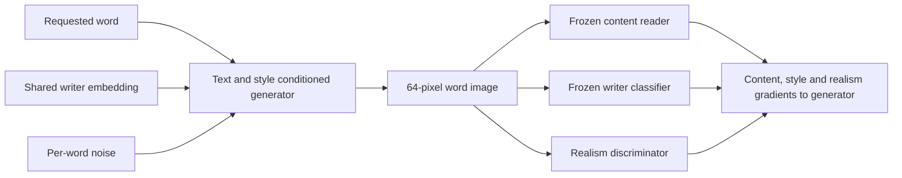

# Word generation: data and model design

> **2 November update:** The multi-network GAN below is retained as an earlier design option, not the immediate training sequence. The single-writer, directly supervised baseline from [the reassessment](generation-reassessment.md) is now implemented; its first bounded manual fit is pending. See [the generator execution guide](word-generator-fit.md). A competent reader remains necessary before relying on it as a spelling-loss network; it does not block this separate supervised experiment. No trained word-generation quality is established, and the product release criteria are unchanged. The sections below describe the earlier GAN proposal and its historical implementation status.

29 October 2026. The word data is prepared and the next model is specified. The content word reader and its manual training/evaluation commands have since been implemented; see [the execution guide](word-reader.md). The style network and word generator remain to be implemented. No word-reader or word-generator training has been launched by the agent. Existing character-model checkpoints remain available; none is presented as the new word model.

## What changes and why

The current cGAN pilot produced stronger strokes but only 8.18% exact-label recognizer agreement and a poorly readable page. The retained VAE achieves 60.92% under that same imperfect scorer. A sharper image alone did not solve content correctness or consistent style.

The next system will receive the full word, a shared writer style and a per-word noise seed. It will generate the word together. A separate content-recognition objective will penalize incorrect text, and a writer-style objective will encourage consistent writing across the page. These choices are informed by [GANwriting](https://arxiv.org/abs/2003.02567) and [Handwriting Transformers](https://openaccess.thecvf.com/content/ICCV2021/papers/Bhunia_Handwriting_Transformers_ICCV_2021_paper.pdf). This is a proposed smaller project architecture, not a reproduction of their reported results.

## Data source and acquisition

IAM 3.0 is now available from its [author-authorized Zenodo migration](https://zenodo.org/records/19003721). The migration states that the original authors permitted publication. The older FKI account requirement is no longer necessary for these public files. The data remains limited to non-commercial research; cite Marti and Bunke, *The IAM-database: An English Sentence Database for Off-line Handwriting Recognition* (2002).

Only three files are needed for this milestone: `words.tar`, `ascii.tar`, and `largeWriterIndependentTextLineRecognitionTask.zip`, totaling approximately 1.26 GB. `ml.iam_download` pins the published MD5 checksums, records SHA-256 hashes and saves the public record metadata. No credentials, model weights or external generation service are involved.

```powershell
.\.venv\Scripts\python.exe -m ml.iam_download
.\.venv\Scripts\python.exe -m ml.iam_import
.\.venv\Scripts\python.exe -m ml.iam
```

These commands download, import and prepare data only. They do not train anything. Existing valid downloads are verified and reused. Import/preparation destinations must be new; do not rerun them against an existing destination. Downloads are in ignored `data/iam-downloads/`, extracted files in `data/iam/`, and preparation reports in `artifacts/iam-words/`.

Archive import creates regular files only, rejects links, path traversal and Windows device paths, limits expansion size, and never overwrites an existing destination. Partial download/import failures remain visible rather than being mistaken for a complete dataset.

## Text and image contract

- Words retain their exact case and supported punctuation. No automatic lowercasing or replacement of labels occurs. This first word-data contract supports the existing 62 alphanumeric characters plus the project's punctuation, without embedded whitespace.
- Images are upright IAM word crops. No EMNIST transpose is applied.
- Height is 64 pixels, with a four-pixel paper margin. The word image is scaled uniformly to fit the remaining 56-pixel height, preserving aspect ratio and grayscale ink. Width is padded to a multiple of eight, up to 384 pixels.
- Words longer than 24 characters, unsupported text, segmentation errors, invalid bounding boxes, corrupt images and images that exceed the width limit are excluded with explicit reasons. Words are never cut off or squeezed to fit.
- Standalone punctuation-only images are excluded from this first word experiment. This narrows the experiment's scope; complete product punctuation coverage is not established.
- Foreground intensity is in [0, 1]; paper and batch padding are zero. Token IDs start at one; zero is reserved for CTC blank and sequence padding. The word contract is separate from the 62-class glyph contract.
- The planned recognizer downsamples width by four. Preparation checks that its time axis can accommodate the transcription, including required blanks between repeated characters.

Training character coverage is reported explicitly. The existence of a token ID does not establish that enough real examples exist to learn that character.

## Partitions and leakage checks

The official line-task partitions contain 283 training writers, 46 validation-1 writers, 43 validation-2 writers and 128 test writers. The importer checks disjoint line IDs and writer identities. It retains those boundaries; it does not randomly mix all word images.

Inside official training lines, deterministic SHA-256 grouping adds two development partitions:

| Partition | Purpose |
| --- | --- |
| `train` | Fit the future generator and real-data auxiliary networks. |
| `content_validation` | Approximately 10% of distinct case-folded word strings. All variants of a selected string are withheld across all training writers, so their word content is unseen during fitting. |
| `seen_validation` | Approximately 10% of remaining source lines, grouped by line ID. These writers are known; their image instances are held out. Vocabulary may be either seen or unseen. |
| `writer_validation1` / `writer_validation2` | Retain the official unknown-writer validation metadata for later generalization work. |
| `test` | Retain official final-test metadata; no quality measurement or pixel inspection during this milestone. |

Preparation decodes only `train`, `content_validation` and `seen_validation` images. Reserved validation/test pixels remain unopened. The initial loader explicitly refuses those reserved partitions. The extra internal splits are project development splits, not official benchmark scores.

The manifest records exact assignments, counts, source hashes, per-character coverage and writer mappings. `IAMWordDataset` verifies the record digest and each loaded source image. `collate_words` returns padded images, actual widths, padded token sequences, unpadded CTC targets, token lengths, writer indices and source IDs. Padding must be masked by future models and losses.

The completed preparation contains 33,348 training words from 283 writers, 4,250 content-validation words and 3,612 additional known-writer validation words. Reserved metadata includes 5,842 validation-1, 6,340 validation-2 and 11,601 final-test words after metadata filters; those are not pixel-validated or quality-scored counts. Of the original 115,320 rows, 64,993 are accepted/reserved and 50,327 are explicitly excluded: 27,398 outside the official task, 13,699 segmentation errors, 8,572 standalone punctuation samples, 520 excessive widths, 118 unsupported transcriptions, 18 invalid bounding boxes and two corrupt images.

A rare training writer can have only one usable line after filtering. If line hashing would place all their remaining samples in `seen_validation`, preparation retains one deterministically selected line for training and records that adjustment. It never moves held-out vocabulary into training. If no eligible training line exists outside held-out content, preparation fails rather than leaking that vocabulary. The initial internal preparation exposed this case for writer 006; `artifacts/iam-prepared/` is retained as a superseded diagnostic, and the corrected output is `artifacts/iam-words/`.

`sanity-set.json` selects at most 16 distinct training words from one writer for a future manual memorization test. Those IDs never come from validation or test. Passing that test would show that the new pipeline can fit a small problem; it would not establish generalization.

## Proposed model, to implement next

| Component | Initial design | Reason |
| --- | --- | --- |
| Text encoder | Character embeddings and a small bidirectional GRU with positional context | Represent the ordered full word and neighboring letters. |
| Style input | Learned writer embedding, fixed across every word on a page | Establish coherent known-writer styles before attempting unseen-writer imitation. |
| Variation input | Small Gaussian latent vector sampled separately for each word | Allow variation while retaining the shared style and exact text. |
| Image generator | Attention from image features to the text sequence; conditioned resize/convolution blocks; variable-width 64-pixel output | Preserve word context and produce grayscale strokes without a font fallback. |
| Width predictor | Predict normalized word width from text and style; supervise against real training widths | Avoid clipping or assuming every letter occupies an identical width. |
| Content network | Small CNN plus sequence recognizer with CTC | Read variable-length text and provide a direct spelling/content loss. |
| Style network | Real-image writer classifier | Provide a writer-consistency loss. |
| Discriminator | Small spectrally normalized image/style discriminator | Encourage realistic strokes and discourage image artifacts. |

All components will be initialized randomly. No downloaded OCR, handwriting, diffusion, vision-backbone or generator weights will be used.

The generator objective will combine adversarial realism, CTC content correctness, writer-style classification and width prediction. Loss weights will be selected on development data after measuring scale and gradient balance; arbitrary initial weights are not a quality claim.

The content and style networks must first learn from real training images and demonstrate useful validation performance. During generator updates their parameters and mutable buffers are frozen, while gradients pass through them to generated pixels. Generated images must not teach those auxiliary readers their own mistakes. Any final word recognizer used as an evaluator must be independent of the training-loss reader; the current isolated-character scorer is not a valid word recognizer.



## Scope of the first model

The first model will support styles learned from training writers. A writer-ID embedding cannot imitate a new person's handwriting from an example image. That later capability needs a reference-style encoder and separate reference/target pools for unseen writers. The reserved official writer-validation partitions support that later experiment; they are not silently added to fitting.

Coverage is an actual constraint in this source: the initial preparation found no training examples for `! ? : ; ( )` under the word filter, and only a handful of occurrences for some capitals, including `Q`, `X` and `Z`. The first learning experiment must report this narrower scope and class imbalance. Full mixed-case/digit/punctuation support needs additional data or a separately validated training strategy; allocating output tokens does not solve that gap. Early style experiments should use a small, well-represented writer subset selected by training counts, before expanding to all styles.

Word-level generation permits within-word connections. It does not itself implement page layout, arbitrary-length lines, signature imitation, exact personal-handwriting cloning or natural cross-word pen trajectories. The existing page compositor will need a word-image interface and baseline/scale calibration after word quality passes. Its current glyph renderer is retained as the existing prototype.

## Training sequence and stopping points

1. Complete data preparation and inspect actual image/transcription/writer grids. Verify character coverage, exclusions and disjoint partitions.
2. Implement the small word model, content/style networks, separate checkpoint contracts and inference/export code. Verify forward shapes, masks and gradient boundaries without optimizer updates.
3. The owner manually runs bounded real-data smoke tests for the auxiliary networks. Check actual real-word reading and writer classification before using them as training losses.
4. The owner manually runs the fixed tiny memorization test. A failure requires debugging before a larger run. Passing remains a training-set diagnostic.
5. Run a capped pilot only after correctness checks, measured runtime and a memory budget. Evaluate fixed unseen words, repeated-letter cases and fixed paragraphs; compare failures as well as attractive outputs.
6. Expand training only when measured content correctness, style behavior and visual readability justify it. Preserve an independent final test and the project's provisional release gates in `docs/acceptance.md`.

The word reader now has a bounded manual smoke/pilot command in `docs/word-reader.md`. There is no word-generator training command yet: its style/content-conditioned architecture and style network still need implementation. Successful reader execution alone would not establish word-generation quality. The owner retains all training execution.

## Compute findings

`python -m ml.runtime_check` performs a read-only runtime inventory and, when CUDA exists, a tiny arithmetic probe with no model or optimizer. It does not install packages or alter Windows settings.

The current machine reports a GTX 1650 with 4,096 MiB VRAM and driver 566.36. The project has PyTorch 2.13.0+cpu, no CUDA runtime and `cuda_available=false`. Its working CPU environment should be retained. A separate compatible CUDA environment must be prepared before claiming GPU readiness; the earlier Windows paging-file import failure has not been repaired. A tiny CUDA probe alone would still not demonstrate that the proposed training fits in 4 GiB.

A small-batch mixed-precision configuration is a candidate to measure, not a confirmed fit or runtime estimate. A research-scale reproduction may require substantially more compute. No paid compute has been requested or used, and no model training was launched for this milestone.

## Completed verification

The full non-training suite passed **120 tests**, with **three optimizer/weight-update tests skipped**, and lint passed. Tests cover preserved case/writer metadata, exact-content holdouts, official split overlap rejection, rare-writer style coverage, no decoding of reserved pixels, variable-width padding, repeated-character CTC feasibility, source/record tampering, unsupported/corrupt-data handling and archive safety.

A separate real-data check loaded 32 images from each development partition, verified checksums, finite padded tensors and CTC lengths, and confirmed that all 16 sanity IDs belong to training. Case-folded training/content-validation overlap is zero, all 283 training writers have a style index, and all original metadata rows are accounted for. The existing trained generator checkpoint is unchanged. Verification is recorded in `.cache/iam-verification.json`; GPU findings are in `artifacts/runtime-check.json`.

The real training-reference contact sheet was inspected visually. It contains downloaded IAM samples and metadata labels, not generated model output. No learned word-generation quality has been established.
